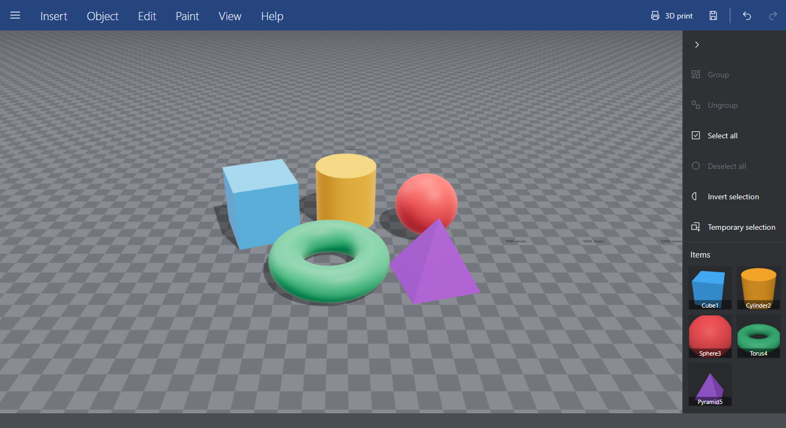
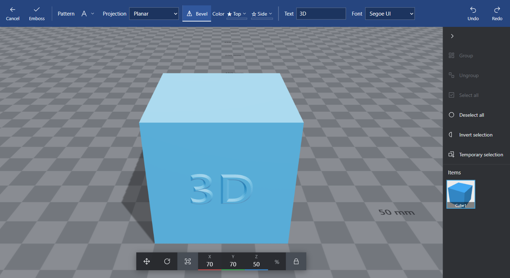
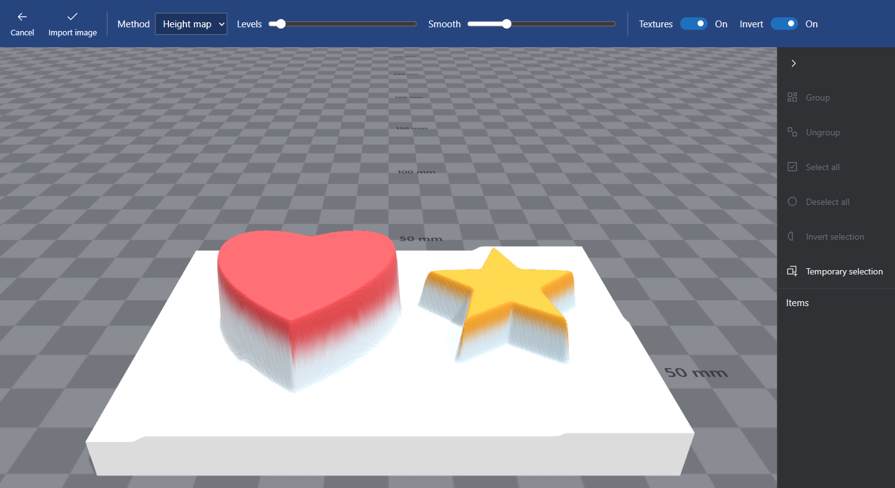

<div align="center">


# 3D Assembler

**Repair and view 3D files in seconds, and get models ready for printing.**<br>
Free, open source, works offline. Inspired by Microsoft 3D Builder.

[Download](#download) • [Features](#features) • [Installing](#installing) • [Documentation](#documentation) • [Report a bug](../../issues)


<a id="download"></a>
<a href="../../releases/latest/download/3D-Assembler-Setup-x64.exe"></a>
<a href="../../releases/latest/download/3D-Assembler-macOS.dmg"></a>
<a href="../../releases/latest/download/3D-Assembler-Linux-x64.AppImage"></a>
<a href="https://bnoa.github.io/3D-Assembler/"></a>

<sub>No account, no upload: everything stays on your computer. <a href="../../releases/latest">All downloads and release notes</a></sub>



</div>

## Repair and view 3D files, fast

This is what 3D Assembler is best at, as 3D Builder was.

- **Repair a broken file in one click.** STL and 3MF files from the internet or from other programs often have holes, flipped faces, duplicated or intersecting triangles, and slicers refuse them or print them wrong. 3D Assembler detects the problems as soon as the file opens and offers to fix them; the repaired model can be saved right away.
- **Look at a 3D file in seconds.** Double-click a .3mf, .stl, .obj, .ply or .glb file and it opens: turn around it, zoom, check its size in millimetres, measure a distance, see its colors.

## Features

* **Build** from ready-made shapes (cube, cylinder, sphere, torus…) or from your own 3MF, STL, OBJ, PLY and glTF files.
* **Edit**: merge, subtract and intersect objects, split them with a plane, smooth, simplify, hollow, extrude down.
* **Emboss** text, shapes or images onto a surface, raised or engraved, with an optional bevel.
* **Paint** faces with colors, or lay textures and stickers on them.
* **Turn an image into a 3D object**: outline, height map, edges or stamp.
* **Check before printing**: thin walls, overhangs, build plate size.
* **Save** as 3MF (with colors and textures), STL, OBJ, PLY or glTF.

<table>
  <tr>
    <td width="50%"></td>
    <td width="50%"></td>
  </tr>
  <tr>
    <td align="center"><sub>Emboss text, shapes or images on any face</sub></td>
    <td align="center"><sub>Turn a picture into a printable relief</sub></td>
  </tr>
</table>

## Why this project

3D Assembler is inspired by Microsoft 3D Builder and is meant as a replacement for the people who used it. Microsoft discontinued 3D Builder in 2024 and removed it from the Microsoft Store ([Microsoft's announcement](https://learn.microsoft.com/en-us/windows/whats-new/deprecated-features)).

It is the work of a 3D printing enthusiast who loved that simple, effective program and was sad to see it go. The goal is to keep that way of working alive and share it with everyone, with no commercial purpose.

The workflow will feel familiar (ribbon, build plate, automatic repair, editing tools). The code is written from scratch, in another language and on other libraries than 3D Builder: it reproduces behaviours, not code. The project contains no Microsoft code, copied or translated, and none of its models, textures, images or help texts. It opens 3MF files made with 3D Builder. If 3D Builder is still installed on your computer, keep it: 3D Assembler does not replace or distribute it.

## Installing

| System | File | First launch |
|---|---|---|
| Windows 10 / 11 | `3D-Assembler-Setup-x64.exe` | Windows SmartScreen may warn about an unknown publisher: click **More info**, then **Run anyway**. |
| macOS 11 or later | `3D-Assembler-macOS.dmg` | Drag the app to Applications. The first time, right-click it and choose **Open**, then confirm. |
| Linux (x64) | `3D-Assembler-Linux-x64.AppImage` | Make the file executable (right-click > Properties > Allow executing, or `chmod +x`), then open it. A `.deb` package is also on the release page. |

The installers are not signed, which is why the systems show a warning the first time.

You can also [use 3D Assembler in your browser](https://bnoa.github.io/3D-Assembler/), with nothing to install. Your files are opened on your computer and never uploaded. In Chrome or Edge you can then install it as an app: the browser offers **Install** in its address bar, or use **Install the app** in the ☰ menu.

**Language.** The interface follows your system language (English, or French on a French system). Change it in ☰ > **Settings** > **Language**.

## Getting help

- **Something does not work, or a file is not repaired correctly?** [Open an issue](../../issues) and, if you can, attach the file.
- **An idea or a question?** Open an issue too, with "Question" or "Idea" in its title.

## Contributing

Contributions are welcome: bug reports, test files that break the repair, translations, code. Please keep to the project's rule: describe and reproduce behaviours, never copy code, images or texts from other programs.

<details>
<summary><b>Building from source</b></summary>

<br>

```bash
npx pnpm@10 install
```

```bash
npx pnpm@10 dev
```

Then open the address shown (by default http://localhost:5173).

| Command | Result |
|---|---|
| `npx pnpm@10 test` | Geometry and repair tests |
| `npx pnpm@10 build` | Static web version in `dist/` |
| `npx pnpm@10 desktop` | Desktop app (Electron), without installing |
| `npx pnpm@10 dist:win` | Windows installer in `release/` (`dist:mac` and `dist:linux` on their own system) |

The GitHub Actions workflow **Installers** (`.github/workflows/installers.yml`) builds the three installers and attaches them to a release when a `v*` tag is pushed. The workflow **Web version** (`.github/workflows/pages.yml`) publishes the browser version on GitHub Pages at each push on `main`.

To keep packages out of a synced folder (OneDrive, Dropbox…), set `store-dir` and `virtual-store-dir` in a local `.npmrc` (ignored by git).

The comparison tests with 3D Builder are optional. They read, when present, the catalog of a local installation (`ASSEMBLER3D_3DB_CATALOG`) and reference files (`ASSEMBLER3D_REFERENCE_DIR`), and are skipped otherwise. None of these files are distributed.

**Technical stack:** TypeScript, [three.js](https://threejs.org/) (3D view), [manifold-3d](https://github.com/elalish/manifold) (solid operations), [Vite](https://vite.dev/), [Electron](https://www.electronjs.org/) (desktop app).

</details>

## Documentation

- [3D Builder's tools and how 3D Assembler reproduces them](docs/3d-builder-tools.md)
- [How the repair works](docs/repair-engine.md)
- [Inventory of 3D Builder's features](docs/3d-builder-inventory.md)

## Preservation

The source code of 3D Assembler is meant to be archived at [Software Heritage](https://www.softwareheritage.org/), the public archive of free software source code, through its [Save code now](https://archive.softwareheritage.org/save/) page. Only 3D Assembler's own code is archived, never 3D Builder.

## License and disclaimer

3D Assembler is released under the [MIT license](LICENSE).

3D Assembler is free and independent software. It is not affiliated with, endorsed or sponsored by Microsoft Corporation. Microsoft, Windows and 3D Builder are trademarks of the Microsoft group of companies. Other names are trademarks of their respective owners. The software is provided "as is", without warranty of any kind.
